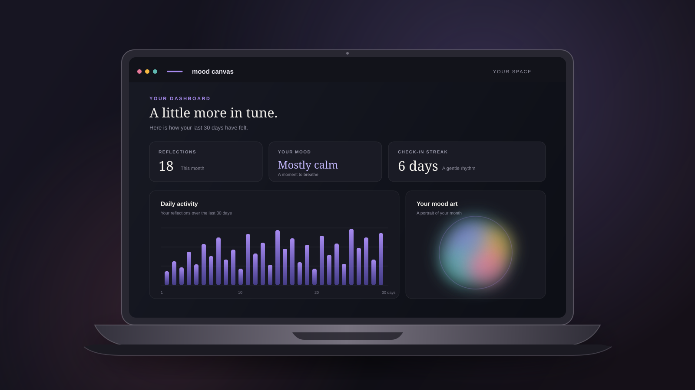

# Mood Canvas

A mood-wellness dashboard. Write a reflection, and Mood Canvas reads its emotional tone with a local, keyword-based analyzer, paints it into downloadable mood artwork, and charts your patterns over time. Everything is scoped to your own account.

<p align="center">
  
</p>

## Features

- **Studio**: write or dictate a reflection (browser speech-to-text where supported) and get an instant mood breakdown, recognized emotion cues, and generated artwork.
- **Dashboard**: 30-day activity, average emotional profile, check-in streak, and recent entries.
- **Mood DNA**: a radar fingerprint of your average emotional profile.
- **Design system**: explore the shared color, type, spacing, theme, and component foundations at `/design-system`.
- **History**: search, filter by mood and date range, sort, paginate, save to gallery, or delete.
- **Analytics**: compare 7 / 30 / 90 day and all-time windows.
- **Gallery**: saved artwork, downloadable as SVG.
- **Settings**: profile, password change, light/dark appearance (stored in the browser), account deletion.

## Requirements

- Node.js 20+
- MongoDB running locally (default `mongodb://127.0.0.1:27017`)

## Setup

```bash
# 1. Frontend dependencies (project root)
npm install

# 2. Backend dependencies and configuration
cd server
npm install
cp .env.example .env     # then set JWT_SECRET to a private value of 32+ characters
cd ..
```

## Run

Start the API and the web app together from the project root:

```bash
npm run dev:full
```

Or run them in two terminals:

```bash
# Terminal 1
npm run dev:api

# Terminal 2
npm run dev
```

Open http://127.0.0.1:5173, create an account at `/signup`, and start reflecting. Vite proxies `/api` requests to the API on port 5000.

## Production build

```bash
npm run build      # outputs dist/
npm run preview    # serves dist/ and proxies /api to port 5000
```

For real deployment, serve `dist/` from your web server or CDN and run the API behind HTTPS with `NODE_ENV=production`.

## Project structure

```
mood-canvas/
├── index.html
├── public/favicon.svg
├── src/
│   ├── main.jsx              # entry: router, theme, auth providers
│   ├── App.jsx               # route table (public + protected)
│   ├── index.css             # design system: tokens, components, responsive rules
│   ├── api.js                # fetch client with bearer-token auth
│   ├── components/           # AppLayout, Logo, MoodArtwork, EmotionBars, ...
│   ├── context/              # AuthContext, ThemeContext
│   ├── lib/                  # emotion palette, artwork generator, formatters
│   └── pages/                # Landing, AuthPage, Dashboard, Studio, MoodDNA,
│                             # History, Analytics, Gallery, Settings
└── server/
    ├── index.js              # Express app, error handling, Mongo connection
    ├── .env.example
    ├── middleware/auth.js    # JWT sign / verify
    ├── models/               # User, Mood (moods collection)
    ├── lib/
    │   ├── analyzer.js       # keyword emotion analyzer (negation, phrases, stems)
    │   ├── analytics.js      # counts, averages, daily series, streak
    │   └── emotions.js       # the seven emotion keys
    └── routes/               # auth.js, emotions.js, moods.js
```

## API

All protected endpoints expect `Authorization: Bearer <token>`.

| Method | Path | Purpose |
| --- | --- | --- |
| POST | `/api/auth/signup` | Create account → `{ token, user }` |
| POST | `/api/auth/login` | Sign in → `{ token, user }` |
| GET | `/api/auth/me` | Current user |
| PATCH | `/api/auth/me` | Update name and/or email |
| PATCH | `/api/auth/me/password` | Body: `currentPassword`, `newPassword` |
| DELETE | `/api/auth/me` | Body: `password`. Deletes account and all reflections |
| POST | `/api/emotions/analyze` | Body: `description`. Analyzes and saves a reflection |
| GET | `/api/moods` | Paginated history. Query: `page`, `limit`, `days` (`7`/`30`/`90`/`all`), `emotion`, `search`, `sort` (`newest`/`oldest`) |
| GET | `/api/moods/analytics` | Query: `days`. Counts, averages, daily activity, streak, latest |
| GET | `/api/moods/gallery` | Saved artwork |
| PATCH | `/api/moods/:id/gallery` | Body: `inGallery` (boolean) |
| DELETE | `/api/moods/:id` | Delete one reflection |

Each saved reflection stores the description, the seven emotion percentages, the dominant emotion, the matched cues, and a timestamp in the `moods` collection.

## Notes

- The analyzer is deliberately simple and transparent. It counts matched words and phrases from seven emotion categories, skips cues that follow a negation ("not happy"), and labels reflections with no recognized cues as neutral. It does not call an external AI service.
- Light/dark preference is stored in `localStorage`. The auth token is also stored in `localStorage`, so use HTTPS in production.
- Streaks and daily activity use UTC dates.
